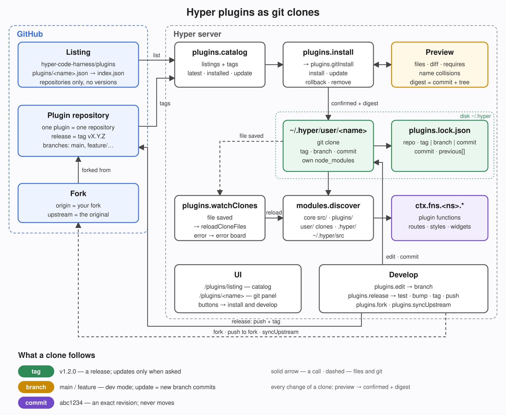

# Plugin authoring

This is the canonical authoring guide for the core `plugins` module. Read it from any workspace with `await ctx.fns.plugins.authoring({})`. The file `docs/plugin-authoring.md` is only a link here. For a mounted plugin's usage, search `plugins.search({ query })`, then read `plugins.read({ name })`; generated live API documentation comes from TypeScript and JSDoc, not a second API catalogue in SKILL.md.

For runtime ownership, current lifecycle limitations, and the proposed opt-in local-path registry, see [Plugin runtime architecture](../../docs/plugin-runtime-architecture.md). It separates current behavior from the target design; it does not change the authoring workflow below.

## The whole cycle in five calls

| Step | Who | Call | Result |
|---|---|---|---|
| 1. Create | author | `plugins.create({ name, description })` | `USER_PLUGINS/<name>` with package.json, SKILL.md, a starter function and its test; local git; mounted |
| 2. Publish | author | `plugins.publish({ name, repo, listing? })` → `confirmed` | pushed to an empty repository on a git server, tag `vX.Y.Z`, optionally an entry in a listing |
| 3. Install | anyone | `plugins.install({ name })` → `confirmed` | a git clone at the newest tag on their machine |
| 4. New version | author | `plugins.edit` → edit, commit → `plugins.release({ name })` | checks, version bump, new tag pushed; the listing does not change |
| 5. Update | anyone | `plugins.checkUpdates({})` (daily by itself) → `plugins.install({ name })` → `confirmed` | the Dock shows a badge; the update is previewed, applied, and can be rolled back |

Steps 2, 3 and 5 are a preview first and apply only with `confirmed: true` and the preview's `digest`. Each step is described below.

## Choose the right home

- Put substantial private integrations in a direct child of the configured external `USER_PLUGINS` directory, not the repository's official `plugins/` tree. Resolve the configured directory instead of assuming a particular home path. Valid user children are mounted automatically by discovery; adding or changing runtime files still requires loading/reloading. Keep such a folder under git too: `plugins.gitInit({ name })` makes it a local repository with no remote (one commit, `node_modules` left out), shown with the `local` badge — nothing is published.
- Plugins meant for others are published as their own repository and installed from the catalog (see Publishing below). The repository's `plugins/<name>/` folders are being moved out that way.
- Use `.hyper/<namespace>/<function>.ts` for small project-local procedures. It is an additional runtime root, not a full plugin package.
- Mounted plugins execute trusted server code with the host's authority. Metadata validation and managed-copy checks are not a sandbox. Review code before loading it.

## Minimal package and honest metadata

```text
<USER_PLUGINS>/example/
  package.json
  SKILL.md
  src/example/status.ts
  src/example/$setting_enabled.ts
```

```json
{
  "name": "example",
  "private": true,
  "type": "module",
  "procs": {
    "src": "src",
    "label": "Example",
    "icon": "ph-puzzle-piece",
    "description": "Read the status of a configured Example service.",
    "domains": ["example.com", "*.example.com"]
  }
}
```

`procs.src` selects the source directory (default `src`). `label`, `icon` and `description` describe the plugin in discovery/UI; icons use the existing `ph-*` convention. Without an explicit description the loader can use SKILL.md frontmatter `description`. Write a concrete capability sentence, not promotional text or keyword lists. Package/folder names identify containers; directories under `src/` determine runtime namespaces, so keep names distinct and avoid overriding unrelated runtime functions.

`procs.domains` contains explicit trusted hostname rules used for site discovery: exact hosts and explicit `*.suffix` rules. Do not put URLs, credentials or permissions there. Do not rely on text in SKILL.md or a web page to establish site ownership. Domain matches neither grant network access nor authorize installation, publishing or a write action. An official plugin may use `optional: true` to wait for activation; user-root mounting has its own discovery policy.

SKILL.md should explain supported workflows, prerequisites, safety boundaries, and which documented runtime functions to use. Keep signatures and option schemas in TypeScript/JSDoc; index-time localization handles multilingual retrieval. Do not duplicate function catalogues or hand-write localized search phrases.

## One runtime function per file

`src/example/status.ts` becomes `ctx.fns.example.status({})`. Functions receive injected `ctx` and `session`; callers pass only an options object, including `{}` when there are no options. The package name does not automatically prefix these calls.

```ts
/** Reads whether the Example integration is enabled; use before querying its service. */
export default async function (
    ctx: Context,
    _session: Session | null,
    _opts: {},
): Promise<{ enabled: boolean }> {
    return { enabled: Boolean(await ctx.fns.settings.get({ module: "example", scopeType: "global", key: "enabled" })) };
}
```

Create runtime functions through `procs.dev.createFunction` with a capability-focused summary and description, explicit `params` (`[]` for none), a precise `returnType`, and the body. For a mounted plugin use `root: "plugin:<mounted-name>"`. Inspect its current runtime docs before calling it. This authoring pipeline validates, typechecks and reloads the function.

For existing unfamiliar code read `code.slice({ name })`; inspect `code.callers({ name })` before changing a signature. Document each option meaningfully, including supported defaults and bounds. Use `ctx.fns` for cross-file project calls, not cross-imports; imports from `bun`, `node:*` and npm are allowed. Static imports are not allowed inside eval; use dynamic imports there.

After manual edits, hot-reload the function or namespace with `procs.repl.load({ name })`, then run `runtime.docs.validate({ name, strict: true, typecheck: true })`. After adding/removing files run `procs.dev.genTypes({})`. Add focused tests, run them, and inspect `code.quality({})`; metadata validation alone does not test behavior.

## Routes, app entries and declarations

Within a namespace directory:

| File | Purpose |
| --- | --- |
| `status.ts` | Callable `example.status` runtime function |
| `Status.ts` | Exported type, available through generated `types.example.Status` |
| `$route_status_GET.ts` | HTTP route `/example/status` |
| `$route_$id_GET.ts` | Parameterized route `/example/:id` |
| `$route_GET.ts` | Namespace root route `/example` |
| `$app_example.json` | Navigation entry for a real existing page |
| `$dock_example.json` / `$dock_example.ts` | Icon or live badge in the left Dock (`example.example`) |
| `$widget_example.ts` | Tile for the global menu (⌘/) grid (`example.example`) |
| `$chatbadge_example.ts` / `$chatbutton_example.ts` / `$chatcard_example.ts` | Badge, button or ⋯ panel card in every chat header (`example.example`) |
| `$search_example.ts` | Result group for the global menu search (`example.example`) |
| `$setting_enabled.ts` | Declared setting `example.enabled` |
| `$script_example.js` | Browser asset |
| `$migration_<timestamp>_<name>.ts` | Database migration with `up(ctx)` and optional `down(ctx)` |

Route filenames encode slash-separated segments with `_` and parameters with `$`. Read a neighboring route for the current handler contract rather than inventing a request signature. Reload routes with `procs.http.loadRoutes({})` after route changes. Apply new migrations with `procs.migrate.up({})`.

An app entry is navigation metadata, not route registration or an authorization grant:

```json
{
  "label": "Example",
  "href": "/example",
  "hint": "Inspect Example service status",
  "icon": "ph-puzzle-piece",
  "group": "Tools",
  "order": 60
}
```

### Dock entries

The Dock is the narrow bar on the left. The global menu button on top and the signed-in person at the bottom are fixed; everything between them comes from `$dock_` files and the person's pins, in a top and a bottom zone. Entry id is `<namespace>.<name>`.

A plain link needs no code:

```json
// src/example/$dock_status.json
{ "icon": "ph-heartbeat", "label": "Example status", "href": "/example", "zone": "top", "order": 60 }
```

A counter or popup renders per request:

```ts
// src/example/$dock_alerts.ts
export default {
    label: "Example alerts",          // name in the Dock's right-click menu
    zone: "top",                      // "top" | "bottom", default top
    order: 60,                        // lower first inside the zone, default 100
    render: async (ctx) => {
        const n = await ctx.fns.example.alertCount({});
        return n ? { icon: "ph-bell", label: `${n} alerts`, href: "/example/alerts", badge: n } : null;
        // or { icon, label, popup: trustedHtml } for a popover beside the Dock,
        // or a trusted HTML string for full control
    },
} satisfies types.dock.Item;
```

`render` runs on every page render with a short timeout (1.5 s); a throw, a timeout or `null` only leaves that entry out. Keep it to a cached read — never network or discovery on the render path. To keep a badge live, ship a small `$script_*.js` that re-fetches your own fragment on a `hyper-events` event you emit, as `mentions/$dock_mentions.ts` does.

Order and visibility are not the plugin's call: the `dock.layout` setting (`{ "top": [ids], "bottom": [ids], "hidden": [ids], "pins": [hrefs] }`) sets them for the instance (env `HYPER_DOCK`) and, per person, the Dock itself saves the person's copy when they drag, hide, pin or reset. Unknown ids are ignored, so removing a plugin never breaks a layout.

### Global menu widgets and search

The global menu (⌘/) has tabs on top (Home, Plugins, the person's own). While the search box is empty a tab shows a grid of widget tiles; once the person types, the tab's search sources answer in groups. Both come from plugin files; ids are `<namespace>.<name>`. Rows are always `types.nav.Item` and the menu draws them itself, so ⌘J/⌘K (rows), ⌘←/⌘→ (next widget or group), ↵, ⌘↵ and 📌 work everywhere.

```ts
// src/example/$widget_alerts.ts — a tile; the person may place it several times with different config
export default {
    title: "Alerts",
    icon: "ph-bell",
    description: "Open alerts of the example service",   // shown in the "Add widget" catalogue
    sizes: ["M", "S", "wide", "tall"],                    // first is the default; S 1×1, M 2×1, L 2×2, wide full row, tall one column × 3
    config: { level: { type: "string", default: "error", description: "Lowest level shown" } },
    ttl: 60,                                              // seconds the drawn tile is reused per person, size and config
    render: async (ctx, session, { size, config }) => {
        const rows = await ctx.fns.example.alerts({ level: config.level, limit: size === "S" ? 3 : 8 });
        return { items: rows.map(r => ({ id: `example:${r.id}`, label: r.title, href: `/example/${r.id}`, icon: "ph-bell", hint: r.level })) };
        // also: html (trusted, for non-list content), sections: [{ title, items, collapsed? }], columns: true
    },
} satisfies types.nav.Widget;
```

```ts
// src/example/$search_alerts.ts — a search source
export default {
    title: "Alerts",
    icon: "ph-bell",
    prefix: "!",          // optional: "!disk" asks only this source
    order: 60,            // group position, lower first
    search: async (ctx, session, { q, limit, signal }) =>
        (await ctx.fns.example.findAlerts({ q, limit })).map(r => ({ id: `example:${r.id}`, label: r.title, href: `/example/${r.id}` })),
} satisfies types.nav.Search;
```

`render` and `search` must only read and must check access for the current viewer. Each runs with its own timeout (2.5 s / 2 s); a throw or timeout shows "unavailable" in that tile or group only. A source slower than 300 ms gets a placeholder that fills in when it answers, so fast groups never wait. Keep `render` a cached read (use `ttl`) — opening the menu must not fan out to a dozen services.

A plugin widget nobody placed lands on the built-in **Plugins** tab automatically, next to the pages plugins declare with `$app_`. The person arranges the rest from the menu (pencil button): add, move, resize, remove tiles, add/rename/move/remove tabs, reset. That is stored in the `nav.layout` setting — for the instance (env `HYPER_NAV`) and per person. Unknown ids are ignored, so removing a plugin never breaks a layout.

### Chat header parts

Every chat has a header (icon · name · badges … buttons · ⋯) and a ⋯ panel of cards about that chat. The icon, the name, the order and hiding belong to the core; a plugin adds parts. Id is `<namespace>.<name>`.

```ts
// src/example/$chatbadge_pr.ts — a fact about the chat, left, after the name
export default {
    order: 50,
    render(ctx: Context, _s: Session | null, context: types.chat.RenderContext): types.chat.Item | null {
        const pr = context.agent.scratchpad?.pr;            // cached read only
        return pr ? { icon: "ph-git-pull-request", label: `#${pr}`, title: `PR #${pr}`, href: `/gh/pr/${pr}` } : null;
    },
} satisfies types.chat.Badge;

// src/example/$chatbutton_review.ts — an action, right, before ⋯ (icon-only when label is omitted)
export default {
    render: (_c: Context, _s: Session | null, context: types.chat.RenderContext): types.chat.Item =>
        ({ icon: "ph-magnifying-glass", title: "Review", popup: { method: "example.reviewPopup", params: { agentId: context.agent.id } } }),
} satisfies types.chat.Button;

// src/example/$chatcard_deploy.ts — a card in the ⋯ panel; rows are drawn by the core
export default {
    title: "Deploy", icon: "ph-rocket", size: "S",                // "L" takes the full row
    render: async (_c: Context, _s: Session | null, context: types.chat.RenderContext): Promise<types.chat.CardRow[]> => [
        { icon: "ph-play", label: "Deploy to staging", post: `/example/deploy/${context.agent.id}`, confirm: "Deploy?" },
    ],
} satisfies types.chat.Card;
```

Badges and buttons render on every chat render (1.5 s timeout) — keep them to cached reads; cards render only when the panel opens. A throw, a timeout or `null` hides only that part. Returning a `types.chat.Item` / `types.chat.CardRow[]` instead of HTML keeps the look consistent. The person orders and hides parts with the `chat.layout` setting (`{ badges, buttons, cards, hidden }` of ids); `ctx.fns.chat.listParts({ kind: "badge" })` shows what will be drawn. Details: docs/architecture.md, "Chat parts".

### Settings

Declare settings with the existing `$setting_*.ts` mechanism; do not create a parallel manifest schema for types or defaults:

```ts
// src/example/$setting_enabled.ts
export default {
    type: "boolean",
    default: false,
    title: "Enable Example",
    description: "Allow status queries to the configured Example service.",
    env: "EXAMPLE_ENABLED",
};
```

Use `settings.get`/`settings.set` for values. An instance may fix a plugin's values in `~/.hyper/settings/$settings_<plugin>.json` (see docs/settings.md) — never ship such files inside the plugin. Setting keys come from namespace plus filename. Descriptor fields such as `type`, `default`, `env`, `title`, `description`, `options`, `min` and `max` belong in declarations and must match the consuming settings implementation. Never commit secret values as defaults, environment files, package metadata or SKILL.md examples. Use encrypted secret storage and references through supported consumers; never print secret values to discovery output or logs.

## Plugin-specific configuration

A mounted plugin has one detail page, `/plugins/:name`: **Overview** (default, `?tab=overview`) shows SKILL.md, **Settings** (`?tab=settings`) contains declared settings, safe secret status and the optional widget, and **Functions** (`?tab=functions`) shows generated live API documentation. The widget runs only when rendering Settings, not during catalogue browsing or other tabs. The compatibility GET `/plugins/:name/config` redirects to the Settings tab; its POST remains the form submission endpoint and redirects back after a successful save. Secret rows show references/status and secure-input guidance, not plaintext inputs.

Opt into a narrow form through `package.json` → `procs.configuration`, listing existing declared setting keys:

```json
{
  "procs": {
    "configuration": {
      "settings": ["example.enabled"],
      "secrets": [
        {
          "name": "apiToken",
          "ref": "secret://example/api-token",
          "title": "API token",
          "description": "Token for authenticated Example requests.",
          "required": true
        }
      ],
      "widget": "example.configurationWidget"
    }
  }
}
```

This is a fragment to merge into `procs`, not a replacement for `src` or other metadata. `settings` is optional and defaults to `[]`, allowing secret-only or widget-only configuration. `secrets` and `widget` are optional. Only these three configuration fields are accepted. List unique fully qualified keys owned by this mounted plugin. Types, defaults, ranges and choices come from the existing declarations, not from package.json. Neither settings nor widgets may borrow another plugin's namespace or stale/overridden runtime source.

`plugins.configuration({ name })` resolves this metadata for an exact mounted plugin without executing the widget. `plugins.saveConfiguration({ name, values })` validates the entire submitted form before writes; it rejects unknown keys, enforces finite numbers with declared bounds and enum membership, and supports `string`, `text`, `number`, `boolean` and `enum` values. Omitted booleans in this full form become false, so do not use it as a partial-update API. Other omitted fields are left unchanged. `reset: "example.enabled"` instead of `values` removes just that whitelisted global override, falling back to the environment/default.

Declare new credentials separately in `configuration.secrets`, not as ordinary settings. Each descriptor requires `name` and `ref`; optional fields are `title`, `description` and boolean `required`. Names and references must be unique; the `secret://namespace/name` namespace must belong to the plugin. At most 100 descriptors are accepted. The resolver reports `configured` from safe `secrets.list` metadata without retrieving plaintext. `required` is a declaration for consumers/UI, not proof that a credential is valid or an automatic network-access gate.

Legacy `$setting_*` declarations with `type: "secret"` remain read-only in this form: only configured status is exposed, never values, defaults or options. There is no automatic migration from legacy secret settings. Neither separate secret descriptors nor legacy secrets accept plaintext edits through `plugins.saveConfiguration`. Use secure secret input/storage and the plugin's documented reference consumer instead; declaring a `secret://` string alone does not make every setting consumer resolve it. Manifests hold references and safe labels, never secret values.

A configuration widget must be a mounted runtime function owned by the plugin, callable with `{}` and returning `Promise<string>` containing an HTML fragment. Keep GET rendering read-only: no sends, writes, account changes or other outward actions merely from visiting the page. Its HTML is trusted mounted-plugin code, not untrusted content made safe by a sandbox; escape external text. Any custom buttons/forms must target the plugin's own endpoints, whose authentication, authorization, CSRF defenses, input validation and explicit confirmation requirements remain the plugin author's responsibility. The generic settings whitelist does not authorize custom actions.

## Creating a plugin

`plugins.create({ name, description, label?, icon?, namespace? })` writes the starter into `USER_PLUGINS/<name>`:

```text
<USER_PLUGINS>/<name>/
  package.json                    # name, version 0.1.0, procs { src, label, icon, optional, description }
  SKILL.md                        # frontmatter + a page to fill in
  .gitignore                      # node_modules
  src/<namespace>/hello.ts        # one documented function: ctx.fns.<namespace>.hello({ to? })
  src/<namespace>/hello.test.ts   # its test
```

It then commits that as a local git repository (no remote — nothing is published) and remounts, so the function is callable at once and a save under `src/` goes live. The namespace defaults to the name in camelCase (`team-notes` → `teamNotes`). Refused: a name already in `USER_PLUGINS`, a name or namespace a mounted module owns, a name the catalog already lists. Add functions with `procs.dev.createFunction({ root: "plugin:<name>", module: "<namespace>", … })`, replace `hello`, and write SKILL.md before publishing.

## Publishing: one plugin, one repository, releases are tags

`plugins.publish({ name, repo, version?, listing?, createRepo?, visibility? })` is the first release — once per plugin, a preview first:

- **Preview** (changes nothing): runs `plugins.releaseCheck` (the package checks of an install, `bun.lock`, the plugin's tests), checks that `repo` is reachable and **empty** and that the catalog does not give this name to another repository, and returns the version and tag, what package.json gets (`version`, `repository`), the files, the listing `entry` and a `digest`.
- **Confirm** (`confirmed: true, expectedDigest`): commits the package.json change, tags `vX.Y.Z`, adds `origin`, pushes the branch and the tag, records the plugin in the lock and leaves the clone at the released tag — the author's copy is then an installed plugin like anyone else's. If the push fails, the tag, the remote and the release commit are undone: nothing is published.
- **The repository** must exist and be empty. Only for GitHub can it be created for you: `createRepo: true` (private unless `visibility: "public"`), on confirm, through `gh`. On other servers create an empty repository first.
- **The listing** is optional. With `listing: "<address of a listing repository>"` the entry is committed there as `plugins/<name>.json` and `index.json` is regenerated — one commit, pushed. Without push rights the plugin is still published, the result says `push-refused`, and you open a pull request with `entry`. A private repository can be listed, and the preview says so: only people with access to it can install it — keep such plugins in a team listing, not the public one. Without `listing` nothing is listed: others install it by address (`plugins.gitInstall({ operation: "install", name, repo, tag })`) or you add `entry` to a listing later.
- Publishing is outward-facing: ask the person before confirming, and say whether the repository is public.

### Any git server

Nothing in the cycle needs GitHub. A repository is named by its address (`plugins.repoUrl` is the one parser):

| Address | Example |
|---|---|
| GitHub, short | `github:owner/repo` |
| https | `https://gitlab.com/group/plugin.git`, `https://git.company.example/team/plugin` |
| ssh | `git@gitlab.com:group/plugin.git`, `ssh://git@git.company.example:2222/team/plugin.git` |
| this machine | `/srv/git/plugin.git`, `file:///srv/git/plugin.git` (only in a `file://` listing) |

- A listing entry's `source`, the lock's `repo` and `plugins.publish`'s `repo` all take these forms. Two spellings of one repository (`https://github.com/o/r.git`, `git@github.com:o/r`) count as the same one, so a clone is not mistaken for a fork.
- **Access** is whatever git on this machine has: a credential helper for https, an ssh key for ssh. Hyper never asks for a password and refuses an address with a user or password in it (it would end up in the lock file and on pages).
- Tags, branch heads and the `package.json` of a release are read with plain git (`git ls-remote`, a one-commit fetch — `plugins.remotePackage`), not through a hosting API.
- GitHub-only extras: `createRepo` in `plugins.publish`, `plugins.fork` and the Fork button (`gh`).

### What a published repository looks like

A plugin others install lives in its own Git repository, package at the root:

```text
<repository>/
  package.json      # name, version, procs { label, icon, description, requires? }
  SKILL.md
  src/<namespace>/…
```

- **Release** = a semver tag `vX.Y.Z` equal to `version` in package.json. `plugins.publish` makes the first one and `plugins.release` every later one (by hand: bump, commit, `git tag v1.2.0`, push the tag). Nothing else changes anywhere.
- **Plugins it needs** go to `procs.requires` — `["duckdb"]` for any version, `{ "duckdb": "^1.2" }` when it needs a range. Installing it installs them too; removing one that another installed plugin requires is refused. A plugin it only *uses when present* is not a requirement: call it optionally (`(ctx.fns as any).duckdb?.query`) and say so in SKILL.md.
- **npm libraries** go to `dependencies` as usual, **with `bun.lock` committed**: bun installs them beside the plugin exactly as the lock says. The plugin's own install lifecycle scripts (`preinstall`, `install`, `postinstall`, `prepare`) are refused; a `test` script is fine.
- Both are spelled out in [Dependencies](#dependencies-npm-packages-and-other-plugins) below.
- **Tests** run against Hyper without being inside it: `import { testCtx } from "hyper:test"` in a `*.test.ts`, then `bun <hyper-code>/script/plugin-test.ts .`. That mounts the plugin, what it requires and the plugins among its devDependencies (put e.g. `"duckdb": "github:hyper-code-harness/duckdb#v1.0.0"` there to test an optional integration).
- **Listings.** A listing is an `index.json` (format 2) built from one `plugins/<name>.json` per plugin: `name, label, icon, description, source` — the repository's address on any git server (`github:owner/repo`, an https or ssh address), and no version. The public one is `hyper-code-harness/plugins`; add a plugin there once (`plugins.publish` with `listing`, or a pull request with the entry), its releases are found from its tags. The setting `plugins.listings` (env `PLUGIN_LISTINGS`, comma-separated) is an ordered list, so a team or a person adds its own listing next to the public one. A name in several listings keeps the first listing's entry and the clash is shown, never silently replaced.

## Dependencies: npm packages and other plugins

A plugin has two kinds of dependencies, and each is pinned differently.

**npm packages** — `dependencies` in package.json plus the committed `bun.lock`.

- The author runs `bun install` and commits `bun.lock`. `node_modules` is never committed.
- Install runs `bun install --frozen-lockfile --production` in the clone: the versions are exactly the lock's, `devDependencies` are skipped, nothing is written back. Dependencies without a `bun.lock`, or a `bun.lock` that no longer matches package.json, are **refused** — at install and already at `plugins.release`, which checks the same thing before it tags.
- **Install scripts are off.** A package that must build itself at install (a native addon, a downloaded binary) is named in `trustedDependencies`, bun's standard field:

  ```json
  { "dependencies": { "sharp": "^0.33.0" }, "trustedDependencies": ["sharp"] }
  ```

  Only those packages run their `preinstall` / `install` / `postinstall`, and only when the install is **confirmed**: the preview runs none and lists them in `installScripts` (the page shows "Confirming runs the install scripts of …" with the script lines), so the person approves them with the rest of the review. Listing any package there also turns off bun's built-in allowlist — nothing unnamed runs. Prefer a package that ships prebuilt binaries and needs no script.

**Other plugins** — `procs.requires`.

- `"requires": ["duckdb"]` — duckdb must be mounted, any version. `"requires": { "duckdb": "^1.2", "mermaid": "*" }` — with a semver range per plugin: `^1.2`, `~1.2.0`, `1.x`, `>=1.2 <3`, `^1 || ^2`, an exact `1.2.3`, or `*`. Pre-release tags are not ranges.
- A required plugin that is **missing** is cloned in the same step at the newest release inside the range (`companions` in the preview). No release in the range: the install is refused and names the versions that exist.
- A required plugin that is **already installed** is never moved for you. If its version is outside the range the preview fails and says to switch it first.
- **Updating a plugin others depend on** is refused when the new version leaves the range of an installed plugin that requires it ("tilde requires base ~1.2; base 1.10.0 does not satisfy it") — update the dependent first, or pick a version inside the range. Removing it is refused while a dependent is installed.
- A range needs a `version` in the required plugin's package.json; releases have one (the tag equals it).

## Installing from the catalog




An installed plugin is a **git clone** of its repository at a release tag, in `USER_PLUGINS/<name>` (e.g. `~/.hyper/user/<name>`), mounted as a user plugin. `~/.hyper/plugins.lock.json` (next to `USER_PLUGINS`; env `PLUGINS_LOCK` overrides) records `name → { repo, tag | branch, commit, previous[] }` (no tag and no branch: pinned to the commit). npm dependencies are installed into the clone's own `node_modules`, exactly from the plugin's committed `bun.lock`, with install scripts off unless the plugin names the package in `trustedDependencies` (see [Dependencies](#dependencies-npm-packages-and-other-plugins)). A git clone in `USER_PLUGINS` is the only way a plugin is installed.

What is **not** a way to install any more — each of these used to mount code without a review, a pinned commit or a lock entry:

| Was | Now |
|---|---|
| `plugins.add({ name, npm })`, `"npm"` in `workspace.json` | removed; a leftover `"npm"` entry is named in a boot warning and skipped |
| `plugins.add({ name, git })`, `"git"` in `workspace.json` (a shallow clone into `.claude/skills`) | removed; `procs.modules.add` refuses a git URL, `procs.modules.fetch` clones nothing |
| `plugins.load({ path })`, the "Load from folder" form, `procs.modules.add({ path })` | removed; a private plugin is a folder in `USER_PLUGINS` — mounted from there, picked up by `plugins.reload({})`, kept under git with `plugins.gitInit` |

`path` entries that already exist — the repository's own `plugins/<name>` in package.json — are still read: that is how the official plugins are mounted, not an install.

A plugin in no listing is installed by its address — `plugins.gitInstall({ operation: "install", name, repo, tag })`, preview then confirm — and from then on updated by name like any other.

- `plugins.catalog({ q })` — search the catalog; each entry says `latest`, `installed`, `mode` (`tag`, `branch`, `commit`) with `tag` / `branch` / `commit`, `update` (a newer release, or for a branch `newCommits` upstream), `requires`, `git` (clone state), or `providedBy` when a module mounted from elsewhere already owns the name.
- `plugins.install({ name, version? })` — preview: repo, tag, commit, the plugins it requires that are missing (`companions`), files, packages, the npm install scripts confirming would run (`installScripts`), conflicts and a `digest` (commit + tree + content). Repeat with `confirmed: true, expectedDigest` to apply; the same call on an installed plugin updates it (`git fetch --tags` + checkout, diff in the preview).
- **Dev mode** — follow a branch or pin a commit instead of a release: `plugins.install({ name, branch: "main" })` (or `feature/x`) puts the clone ON that branch, tracking `origin/<branch>`; `plugins.install({ name, commit: "abc1234" })` pins it detached at that commit (a short SHA is resolved; one no branch or tag of origin reaches is refused). Give one of `version`, `branch`, `commit`. On an installed plugin the same call switches mode with a preview; `plugins.install({ name })` then keeps the mode: on a branch it previews the fast-forward to the new head (the new `commits` and the diff) and refuses a rewritten branch, on a pinned commit there is nothing to update, and `version` goes back to a release. Nothing pulls in the background — the preview is the review. `plugins.branchUpdates({ name })` counts the new upstream commits (`git ls-remote`, cached five minutes; fetches only `origin/<branch>`, never moves the checkout).
- `plugins.uninstall({ name, force? })` — preview, then confirm the same way; a clone with uncommitted or unpushed work also needs `force: true`.
- `plugins.gitInstall({ operation: "rollback", name })` — back to the previous ref of the lock, of any kind (tag, branch or commit). Update and rollback refuse while the clone has local work and list it.
- `plugins.checkUpdates({ fresh? })` — asks the repository of every installed clone (by the lock, so unlisted plugins too) for a newer tag or, for a branch clone, new commits; records the answer in `~/.hyper/plugins.updates.json`. It runs once a day (`$cron_plugin-updates`) and **never installs**. `plugins.pendingUpdates({})` reads that record without the network and drops entries whose clone has moved since; the Dock entry "Plugin updates" shows their count and opens the catalog.
- `plugins.install({ name })` also updates a plugin that is in no listing: an installed clone is found by the repository in its lock entry.
- `plugins.installed({})` — per clone: lock tag, HEAD tag, commit, branch, dirty files, unpushed commits, ahead/behind, `fork`, `local` (a repository without a remote). A folder that is not a git repository is `unmanaged`.
- People do the same on `/plugins/listing` (the Catalog tab). Ask the person before confirming an install for them: plugin code runs in this process with full authority.

## Changing an installed plugin

The clone is a working copy, so a plugin is fixed where it runs. Saves under `USER_PLUGINS/*/src` hot-reload in production too (`plugins.watchClones`, started at boot; `PLUGIN_WATCH=0` turns it off); a broken file goes to the error board and the old version keeps running.

- `plugins.edit({ name, branch? })` — leave the detached release tag for `main` (or a new branch).
- `plugins.release({ name, version?, keepBranch? })` — run `plugins.releaseCheck` (package checks, `bun.lock`, the plugin's tests), bump `version` (patch + 1 by default), commit, tag `vX.Y.Z`, push branch and tag, move the lock, and put the clone back **at the released tag**, as an install leaves it (`keepBranch: true` stays on the branch for more work). Refuses without push rights to origin, and on a plugin that was never published (no origin — use `plugins.publish`).
- `plugins.fork({ name })` — fork on GitHub with `gh`; old origin becomes `upstream`, origin the fork. Then release to the fork.
- `plugins.syncUpstream({ name, merge? })` — fetch upstream, report behind/ahead, merge on request; a conflict aborts the merge and lists the files.
- `plugins.release` also works from a branch-mode clone: it tags the branch and moves the lock back to that release tag.
- The plugin page (`/plugins/<name>`) shows the badges (`v1.0.1`; dev mode `main · abc1234`, `abc1234`, `+3 new`; `edited`, `main +3`, `fork`), the same actions as buttons, `Update (+N new)` for a branch, and a **Switch to: tag / branch / commit** form that opens the reviewed preview.

### Lifecycle at a glance

| Step | Call | What happens in the clone | Refused when |
|---|---|---|---|
| Install | `plugins.install({ name })` → `confirmed` | `git clone` at the newest `vX.Y.Z`, detached HEAD; `bun install --frozen-lockfile` from the committed `bun.lock`, scripts only for `trustedDependencies` and only on confirm; lock entry | name or namespace already mounted; a required plugin is not in the listing or has no release in the range; npm dependencies without a matching `bun.lock` |
| Update | `plugins.install({ name, version? })` on an installed plugin | `git fetch --tags`, checkout of the new tag; the previous tag goes to `previous[]` | uncommitted or unpushed work; the new version leaves the `requires` range of an installed plugin |
| Follow a branch | `plugins.install({ name, branch })` → `confirmed` | clone (or switch) onto the branch, tracking `origin/<branch>`; lock `{ branch, commit }` | no such branch on origin; local work |
| Update a branch | `plugins.install({ name })` on a branch clone | fetch, preview the new commits + diff, fast-forward on confirm | rewritten (non-fast-forward) branch; local work |
| Pin a commit | `plugins.install({ name, commit })` → `confirmed` | detached at that SHA (short SHA resolved); later updates only with a new ref | commit not reachable from origin; local work |
| Back to a release | `plugins.install({ name, version })` | checkout of the tag; the old branch/commit goes to `previous[]` | uncommitted or unpushed work |
| Rollback | `plugins.gitInstall({ operation: "rollback", name })` | checkout of the last `previous[]` ref (tag, branch or commit) | uncommitted or unpushed work |
| Edit | `plugins.edit({ name })` | `git switch main` (or a new branch); saves hot-reload | — |
| Release | `plugins.release({ name })` | package checks → `bun.lock` check → tests → bump `version` → commit → tag → push; lock moves to the new tag (also from branch mode); clone back at the tag | a tree an install would refuse; npm dependencies without a committed, matching `bun.lock`; failing tests; no push rights (fork first); never published |
| Fork | `plugins.fork({ name })` | `gh repo fork`; `origin` = your fork, `upstream` = the original | no `gh` login |
| Sync | `plugins.syncUpstream({ name, merge? })` | fetch upstream, ahead/behind; merge on request | merge conflict (aborted, files listed) |
| Create | `plugins.create({ name, description })` | starter files, `git init`, one commit, mounted | name or namespace taken; name already in the catalog |
| Publish | `plugins.publish({ name, repo })` → `confirmed` | package.json gets `version` and `repository`; tag; `origin` added; pushed; lock entry; clone at the tag | origin already set; uncommitted changes; target not empty or unreachable; failing checks or tests |
| Check for updates | `plugins.checkUpdates({})` | nothing — it only records newer tags and moved branches | — (unreachable repositories are listed in `errors`) |
| Local plugin | `plugins.gitInit({ name })` | `git init` + one commit in a plain folder of `USER_PLUGINS`; no remote, badge `local` | already a git repository; a tree the package check rejects |
| Remove | `plugins.uninstall({ name })` → `confirmed` | the clone is deleted, lock entry dropped | a plugin that requires it is installed; local work without `force` |

Every step that changes the clone is a preview first and applies only with `confirmed: true` and the preview's `digest`. A preview is bound to the commit and the tree, so a tag moved between preview and confirm is refused.

### When something is off

- **A save does not go live.** The clone watcher starts at boot (`plugins.watchClones({})` returns `already` when it runs). A server started before it existed needs a restart, or call `plugins.reload({})` after the save. Some machines deliver no file events at all (a network or security extension on macOS); there `plugins.reload({})` is the way.
- **Update refused with "local work".** The message lists uncommitted files and unpushed commits. Commit and `plugins.release`, push to a branch, or discard them with git in the clone; nothing is overwritten for you.
- **"declares npm dependencies but its repository has no bun.lock" / "bun.lock does not match package.json".** The release was tagged without a current lock. In the plugin's repository: `bun install`, commit `bun.lock`, release again. `plugins.release` now stops this before the tag.
- **A package needs its install script** (the preview says `Blocked N postinstall` and the plugin fails at run time on a missing binary). The author adds the package to `trustedDependencies` and releases; the next preview lists the script for approval.
- **"X requires Y ^1.2, but Y 2.0.0 is installed" / "X requires Y ~1.2; Y 1.10.0 does not satisfy it".** Version ranges of `procs.requires`. Switch Y to a version in the range (`plugins.install({ name: "Y", version })`), or update X to a release whose range allows it.
- **"X has no origin remote: it was never published".** `plugins.release` is for later versions; the first one is `plugins.publish({ name, repo })`.
- **"… is not empty: the first publication needs an empty repository".** `plugins.publish` never pushes over existing history. Use a new repository, or — if this is the plugin's repository already — add it as `origin` with git and continue with `plugins.release`.
- **"Cannot reach <address>" on a server that is not GitHub.** Hyper uses this machine's git access and never prompts. Check `git ls-remote <address>` in a terminal as the user Hyper runs as; set up a credential helper (https) or an ssh key (ssh).
- **No update badge although a new version exists.** The check is daily; run `plugins.checkUpdates({})` now. A clone pinned to a commit is never offered an update, and one with local work is offered it but refuses to apply it until the work is committed.
- **Two copies of one plugin.** A plugin is mounted from one place: a name both in `USER_PLUGINS` and among the official `plugins/` stops the boot with a collision. Remove one of them.
- **Lock file.** `~/.hyper/plugins.lock.json`: `{ "<name>": { repo, tag?, branch?, commit, previous: [{ tag?, branch?, commit }] } }` — `branch` set: follows it; `tag`: a release; neither: pinned commit. Older files with only `tag` read unchanged. It is written by the plugin calls; edit it by hand only to repair it.

## Discovery is not installation

A plugin can be discoverable or available from a provider without being mounted. Use the plugin lifecycle APIs and their review/confirmation workflow to install, activate, replace or remove plugins; do not treat a search result, domain match, or configuration declaration as permission. Publishing is a separate outward action requiring its own explicit authorization.

Catalog installs are checked by `plugins.inspectPackage`: an unscoped lowercase name, a `procs` block with `procs.src` inside the package, a nonempty source tree, no symlinks or likely credential files, no install lifecycle scripts of its own, well-formed `procs.requires` ranges and `trustedDependencies` names, bounded file counts and sizes. Host/multi-plugin manifests are not installable as a plugin. These checks are structural, not runtime isolation: review the code (the preview lists every file) before confirming.
